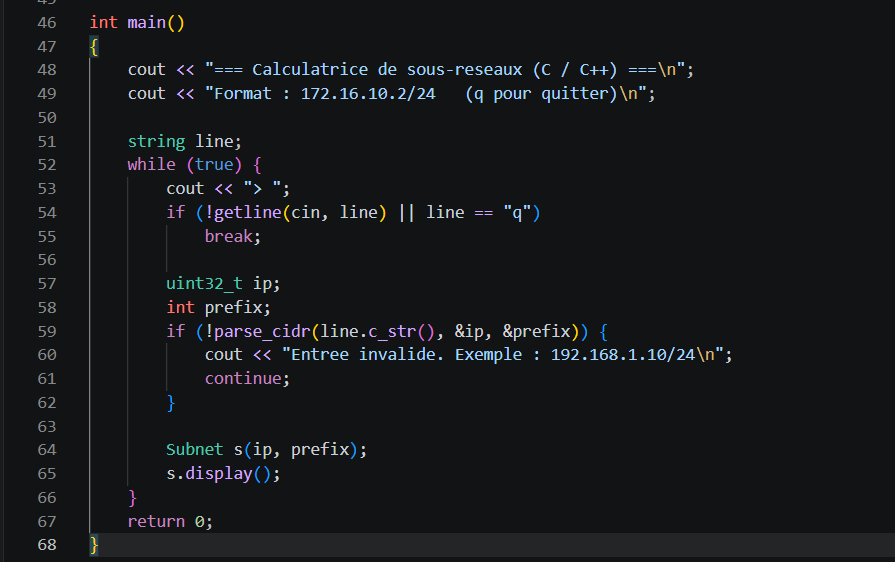

# Calculatrice de sous-réseaux (C / C++)

Programme en ligne de commande qui calcule les informations d'un sous-réseau IPv4 à partir d'une adresse au format CIDR (ex. `172.16.10.2/24`).

## Fonctionnalités

- Adresse réseau et adresse de broadcast
- Masque de sous-réseau
- Premier et dernier hôte utilisables
- Nombre d'hôtes utilisables
- Gestion des cas particuliers `/31` (lien point à point) et `/32` (hôte unique)
- Vérification de la validité de l'entrée

## Répartition des langages

| Fichier | Langage | Rôle |
|---|---|---|
| `subnet.h` | C / C++ | Déclaration des fonctions (compatible C++ via `extern "C"`) |
| `subnet.c` | **C** | Calculs bas niveau : analyse de l'adresse, masque, opérations sur les bits |
| `main.cpp` | **C++** | Classe `Subnet`, affichage et interaction avec l'utilisateur |

## Compilation

Avec GCC (MinGW sous Windows) :

```
gcc -c subnet.c -o subnet.o
g++ main.cpp subnet.o -o subnet
```

Exécution :

```
./subnet        (Linux / macOS)
subnet.exe      (Windows)
```

## Principe de calcul

- Masque = les `n` premiers bits à 1 (`0xFFFFFFFF << (32 - n)`)
- Adresse réseau = `IP & masque`
- Broadcast = `réseau | ~masque`
- Hôtes utilisables = `2^(32 - n) - 2`

## Compétences mises en œuvre

- Programmation en C et en C++
- Opérations bit à bit
- Programmation orientée objet (classe `Subnet`)
- Interopérabilité C / C++ (`extern "C"`)
- Compilation séparée
- Notions de réseaux IPv4 et de subnetting

## Captures d'écran

### 1. Résultat de l'exécution


### 2. Code principal



## Pistes d'amélioration

- Découpage d'un réseau en plusieurs sous-réseaux (VLSM)
- Saisie du masque au format `255.255.255.0`
- Affichage binaire des adresses
